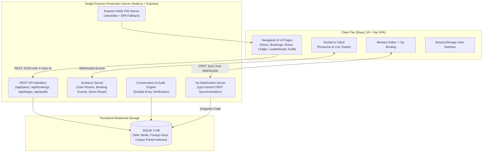

# SkillSwap — Judge Evaluation & Technical Evidence Guide

This document maps all problem requirements, minimum working versions, architectural rules, and bonus goals to concrete implementation files, UI locations, and automated integration tests.

---

## 🏛️ System Architecture



---

## 📊 Requirements to Evidence Matrix

| Specification Item | Status | Where to See in UI | Implementation Files | Automated Test Proof |
| :--- | :---: | :--- | :--- | :--- |
| **1. Smart Matching / Peer Directory** | **DONE** | Nav: **Find Peers** (`/`) | [`client/src/pages/Directory.jsx`](file:///f:/HackathonCodeAsap/client/src/pages/Directory.jsx), [`server/src/routes/peers.js`](file:///f:/HackathonCodeAsap/server/src/routes/peers.js) | `profile.test.js` |
| **2. Session Booking & Slot Selection** | **DONE** | Peers Card -> **"Book Session"** Modal | [`client/src/components/BookModal.jsx`](file:///f:/HackathonCodeAsap/client/src/components/BookModal.jsx), [`server/src/bookings.js`](file:///f:/HackathonCodeAsap/server/src/bookings.js) | `bookings.test.js` |
| **3. Live Collaboration Room** | **DONE** | Bookings -> **"Join Room"** (`/room/:id`) | [`client/src/pages/Room.jsx`](file:///f:/HackathonCodeAsap/client/src/pages/Room.jsx), [`server/src/yjs.js`](file:///f:/HackathonCodeAsap/server/src/yjs.js) | `room.test.js`, `prod.test.js` |
| **4. In-Room Collaborative Code Editor** | **DONE** | Room Editor (Monaco + Yjs Binding) | [`client/src/pages/Room.jsx`](file:///f:/HackathonCodeAsap/client/src/pages/Room.jsx), [`server/src/yjs.js`](file:///f:/HackathonCodeAsap/server/src/yjs.js) | `room.test.js` (CRDT convergence) |
| **5. In-Room Real-Time Chat & Presence** | **DONE** | Room Right Drawer | [`client/src/pages/Room.jsx`](file:///f:/HackathonCodeAsap/client/src/pages/Room.jsx), [`server/src/sockets.js`](file:///f:/HackathonCodeAsap/server/src/sockets.js) | `room.test.js` (Chat & presence) |
| **6. Credit Ledger & Double-Entry Accounting** | **DONE** | Nav: **Profile & Ledger** (`/profile`) | [`client/src/pages/Profile.jsx`](file:///f:/HackathonCodeAsap/client/src/pages/Profile.jsx), [`client/src/components/LedgerTable.jsx`](file:///f:/HackathonCodeAsap/client/src/components/LedgerTable.jsx), [`server/src/ledger.js`](file:///f:/HackathonCodeAsap/server/src/ledger.js) | `ledger.test.js` |
| **7. Real-Time Sockets & Toasts** | **DONE** | Global Screen Toasts & Nav Badges | [`client/src/components/Toasts.jsx`](file:///f:/HackathonCodeAsap/client/src/components/Toasts.jsx), [`server/src/sockets.js`](file:///f:/HackathonCodeAsap/server/src/sockets.js) | `sockets.test.js` |
| **8. Double-Spend Prevention** | **DONE** | Book Session Modal (rejection on low funds) | [`server/src/ledger.js`](file:///f:/HackathonCodeAsap/server/src/ledger.js), [`server/src/bookings.js`](file:///f:/HackathonCodeAsap/server/src/bookings.js) | `ledger.test.js`, `bookings.test.js` |
| **9. Full Audit & Credit Conservation** | **DONE** | Nav: **Audit** (`/audit`) | [`client/src/pages/Audit.jsx`](file:///f:/HackathonCodeAsap/client/src/pages/Audit.jsx), [`server/src/routes/audit.js`](file:///f:/HackathonCodeAsap/server/src/routes/audit.js) | `integrity.test.js` |
| **10. Deterministic Seed Data** | **DONE** | System-wide (14 users, 25 bookings, 64 entries) | [`server/src/seed.js`](file:///f:/HackathonCodeAsap/server/src/seed.js) | `db-sanity.js`, `demo.test.js` |
| **BONUS: Session Notes Archive** | **DONE** | Nav: **Session Notes** (`/notes` & `/sessions/:id`) | [`client/src/pages/SessionNotes.jsx`](file:///f:/HackathonCodeAsap/client/src/pages/SessionNotes.jsx), [`server/src/yjs.js`](file:///f:/HackathonCodeAsap/server/src/yjs.js) | `slice7.test.js` |
| **BONUS: Rating System & Bonus Credits** | **DONE** | Learner post-session modal & Bookings Rate btn | [`client/src/components/RatingModal.jsx`](file:///f:/HackathonCodeAsap/client/src/components/RatingModal.jsx), [`server/src/ledger.js`](file:///f:/HackathonCodeAsap/server/src/ledger.js) | `slice7.test.js` |
| **BONUS: Leaderboard & Experience Badges** | **DONE** | Nav: **Leaderboard** (`/leaderboard`) | [`client/src/pages/Leaderboard.jsx`](file:///f:/HackathonCodeAsap/client/src/pages/Leaderboard.jsx), [`server/src/routes/leaderboard.js`](file:///f:/HackathonCodeAsap/server/src/routes/leaderboard.js) | `slice7.test.js` |
| **BONUS: Voice / Video Integration** | **NOT DONE** | *(Excluded per deliberate hackathon scoping)* | N/A | Honest admission: voice/video is not built. |

---

## 💰 Credit Flow Economics

SkillSwap operates an egalitarian, closed-loop token economy with explicit supply rules:

```
                  +--------------------------------+
                  |  Initial System Welcome Grant  |
                  |     (+10 credits per user)     |
                  +---------------+----------------+
                                  |
                                  v
                  +--------------------------------+
                  |      User Balance Account      |
                  +---------------+----------------+
                                  |
                 [Booking Accepted / In Progress]
                                  |
                                  v
                  +--------------------------------+
                  |   Dynamic Reservation Layer   |
                  |  (Available = Balance - Held)  |
                  +---------------+----------------+
                                  |
                         [Session Completed]
                                  |
                +-----------------+-----------------+
                |                                   |
                v                                   v
  +---------------------------+       +---------------------------+
  |    Learner Spend (-5)     |       |     Mentor Earn (+5)      |
  | (kind: 'session_spend')   |       |   (kind: 'session_earn')  |
  +---------------------------+       +---------------------------+
                                                    |
                                          [5-Star Review Given]
                                                    |
                                                    v
                                      +---------------------------+
                                      |    System Bonus (+1)      |
                                      |      (kind: 'bonus')      |
                                      +---------------------------+
```

1. **Minting (Supply Expansion)**:
   - Initial grant: 10 credits minted per user at account creation (`kind = 'grant'`).
   - Quality incentive: 1 credit minted by system directly to mentor upon receiving a 5-star review (`kind = 'bonus'`).
2. **Transfer (Zero-Sum Settlement)**:
   - Completed 1-hour session: 5 credits subtracted from learner, 5 credits added to mentor ($\Delta_{\text{net}} = 0$).
3. **Reservation (Dynamic Non-Locking)**:
   - No funds are escrowed in separate intermediate accounts; balance stays in the user's account, but cannot be committed to multiple bookings simultaneously.
4. **Conservation Formula**:
   $$\sum \text{Ledger Deltas} = \sum \text{Grants} + \sum \text{Bonuses} \equiv \sum \text{User Balances}$$
   Every transaction is validated by `GET /api/audit`.

---

## ⚖️ Honest Disclosures & Technical Limitations

1. **Authentication**: Authentication is a user switcher (no real login or passwords). User identity is stored in `sessionStorage` and passed via `X-User-Id` HTTP headers and Socket.io `auth` payloads so evaluators can inspect both sides of a mentorship pair instantly.
2. **Yjs State**: Yjs documents live in memory during active collaboration sessions (`Map<string, WSSharedDoc>`). Final editor code is snapshotted into SQLite `session_notes` upon session settlement, after which in-memory documents are closed and deleted.
3. **Voice / Video Call**: Voice/video is not built. Real-time media streaming was omitted to focus on CRDT code synchronization, atomic credit ledger integrity, and automated testing.
4. **Database Topology**: SQLite single file database in WAL mode (`server/data/skillswap.db`), using `better-sqlite3` with an automatic `node:sqlite` fallback when `better-sqlite3` native compilation is unavailable.

